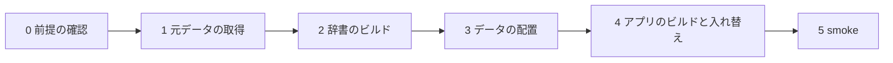
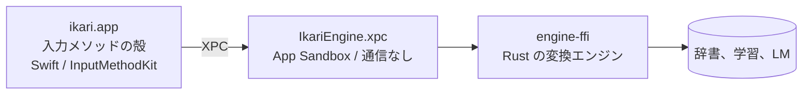

# ikari-ime

ikari-ime は、文脈に応じて同音異義語を選び分ける日本語の入力メソッド（IME）です。macOS で動きます。
「ひんし」と打ったとき、前後の文から「瀕死」ではなく「品詞」を選ぶ、といった誤変換を減らすことが目的です。
短く確定しながら書くことを前提にしていて、確定した語が次の変換の手がかりになります。

このリポジトリはソースを公開しています。**ビルド済みのアプリは、まだ配っていません。** 使うには、Mac でソースからビルドしてください。

0.x の版から、未署名のビルド済み macOS 版を GitHub Releases で配る予定です（最初の公開は 0.1.0 の予定。[ロードマップ](docs/roadmap.md)）。公開のときに、未署名のアプリを開く手順を足します（未確認のため、まだ書いていません）。

## 1. ikari とは

名前の**ikari** は「怒り」「錨」「碇」の 3 つの意味を持ちます。このIMEが解く問題そのものが名前になっています。

- **怒り**: 既存の IME の誤変換への怒りが、開発の動機です。「ひんし」と打って「瀕死」ではなく「品詞」を出す、といった問題を解きます。
- **錨**: 確定した語が錨になり、文脈をつなぎ止めて、次の変換を正しい方向へ導きます。
- **ケッジング**: 確定した語を足がかりに次の語へ進む書き方は、錨を前方に下ろして鎖を巻き上げる操船術と同じです。

## 2. 方針の 3 本柱

1. **ユーザーの思考を止めない。** 変換が外れて手戻りが起きると思考が止まります。こまめに確定しながら書けることを優先します。
2. **ユーザーの意図に忠実にする。** 入力していない文字は足しません（補完をしない）。読みから漢字や記号に変わる候補は、ユーザーが選ぶ「変換」として出します。入力の結果を変える機能は既定でオフです。
3. **速さは補完ではなく、入力配列とショートカットで出す。** 予測変換やサジェストは入れません。

候補は辞書から作ります。言語モデル（LM）は、辞書の候補を並べ替えるためだけに使います。
入力された文字列が起点で、最終的な表記を選ぶのはユーザーです。

## 3. 何ができるか

- **文脈つきの変換**: 直前に確定した語などを手がかりに、同じ読みの候補を並べ替えます。
- **文節の変換**: 最初の Space で読み全体の候補を出します。←/→ と Shift+←/→ で文節を選び、区切りを直せます。
- **再変換**: 確定した文字を、もう一度候補に変え直せます。
- **入力方式**: ローマ字入力と JIS かな入力に対応します。字種の変換（ひらがな、カタカナなど）はキーで行います。
- **英語のモード**: 打鍵をそのままアプリに渡します。英字を入れるときに切り替えます。
- **ユーザー辞書と学習**: 単語を登録できます。学習は、ユーザーの選択を候補の順位づけに使うための支援で、候補を決めるものではありません。
- **設定アプリ「ikari 設定」**: 入力、変換、ユーザー辞書、学習とデータ（エクスポート、インポート、リセット）を管理します。
- **LM による並べ替え**: zenz（小型の日本語モデル）を使います。`--no-lm` で使わない構成にもできます。

機能の一覧（実装済み、一部、予定）は [docs/features.md](docs/features.md) にあります。

## 4. 状態とロードマップ

フェーズ 3a まで完了しています。変換エンジン、macOS 版の入力メソッド、設定アプリが動きます。
英語のモードも入っています。構成の詳細と、いま何が動くかは [docs/architecture.md](docs/architecture.md) の「状態」の行にあります。

今後の計画は [docs/roadmap.md](docs/roadmap.md) に、これまでの検討の経緯（何を試し、何をやめたか）は [docs/history/](docs/history/README.md) にあります。

## 5. インストール（ソースからのビルド）

### 前提

| 必要なもの | 内容 |
| --- | --- |
| macOS | Apple Silicon の Mac（`aarch64-apple-darwin`） |
| Xcode 27 とそのコマンドライン | Swift 6.4（SwiftPM、codesign、xcodebuild を使います）。`xcodebuild` は Xcode 本体に入っているので、コマンドラインツールだけでは足りません |
| Rust | `rustup` で入れます。`aarch64-apple-darwin` 向けに作ります |
| cmake | **既定の構成（`make setup`。LM あり）では必要です**（`brew install cmake`。Homebrew が要ります。llama.cpp をビルドするため）。LM を使わないなら不要です。`make setup-lm-off` を使います |
| ディスク | 数 GB の空きを用意してください。`setup.sh` は空きが 1 GB 未満だと止まります。作者の `data/` は評価用のデータを含めて約 3 GB です。辞書の生成物は `data/build/dict/` に作り、前の版を `dict.prev/` に 1 世代残します |
| 通信 | 初回の元データの取得、Cargo と Swift の依存パッケージの取得（SwiftProtobuf は GitHub から）、Homebrew と rustup の導入だけです（IME 本体は通信しません。[プライバシー](#7-プライバシー)） |

#### かかる時間と容量の目安

- **元データの取得**: 回線しだいです。chiVe の圧縮ファイルが約 594MB、zenz のモデル（Q5_K_M）が約 74MB です（[ADR 0002](docs/adr/0002-phase1-architecture.md)）。SudachiDict も取ります。
- **辞書のビルド**: 約 30 秒です（[ADR 0030](docs/adr/0030-abr-town-vocabulary.md) の測定で 26〜29 秒。元データの取得は含みません）。
- **アプリのビルド**: 初回は Rust と Swift のビルドに時間がかかります。時間は測っていません。

### 署名

macOS の入力メソッドは、署名されたアプリとして入ります。このリポジトリは 2 つの方式を用意しています。

| 方式 | 指定 | 必要なもの |
| --- | --- | --- |
| adhoc | `SIGNING=adhoc`（既定） | 何もいりません。Apple の開発者アカウントは要りません |
| team | `SIGNING=team` | 自分の Apple Development 証明書（キーチェーン）。チーム ID は自分のものを指定します（[自分の名前で作る](#自分の名前で作る)） |

作者個人の証明書とチーム ID は、他の人の Mac では使えません。そのため、team 署名を使うには自分の証明書と ID を指定します。
証明書がなければ adhoc を使ってください。

### 1 コマンドで通す

```sh
git clone <リポジトリの URL>
cd ikari-ime
make setup
```

`make setup` は `scripts/setup.sh --fetch --signing adhoc` を実行します。内部の段は次のとおりです。



1. 前提の確認（コマンド、ディスクの空き、証明書）
2. 元データの取得（SudachiDict、chiVe、zenz。`--fetch` のときだけ通信します）
3. 辞書のビルド（`data/build/dict/` に作ります）
4. データの配置（`~/Library/Application Support/ikari-ime/` へ）
5. アプリのビルドと `~/Library/Input Methods` への入れ替え
6. smoke（アプリの動作確認）

2 回目以降は、取得は正しいファイルがあれば何もしません。辞書は、入力（元データとポリシー）の sha256 が前回と同じなら作り直しません。データの配置は、内容が同じファイルを飛ばします。アプリは毎回ビルドします。

smoke は、インストールしたアプリに変換や学習の試験を流します。次の点に注意してください。

- ikari を入力ソースに選んだままでは実行できません（「実行できない」と出て、終了コード 2 で止まります）。ABC などに切り替えてから流してください。
- 本物のユーザーデータに、見張り用の語を一時的に追加して消します。学習のリセットやインポートは行いません。
- smoke を飛ばすには `scripts/setup.sh --skip-smoke` を使います。

`scripts/setup.sh` のオプションは次のとおりです（`scripts/setup.sh --help` が正です）。

| オプション | 意味 |
| --- | --- |
| `--signing team\|adhoc` | 署名の方式（setup.sh の既定は team。`make` の既定は adhoc） |
| `--no-lm` | LM を使わない構成にする（cmake とモデルが要りません） |
| `--fetch` | 足りない元データを取得する。付けないと、足りないときに案内を出して止まります |
| `--rebuild-dict` | 入力が前回と同じでも辞書を作り直す |
| `--skip-app` | アプリのビルドと入れ替え（と smoke）を飛ばす |
| `--skip-smoke` | smoke を飛ばす |
| `--no-install` | アプリを入れ替えない。ビルドまでを行い、install と smoke は実行するコマンドを表示するだけにする |

### make の入口

`make help` で一覧を出せます。

| コマンド | 内容 |
| --- | --- |
| `make setup` | 取得から辞書、データ、アプリの入れ替え、smoke まで（LM あり。初回は通信と数 GB が要ります） |
| `make setup-lm-off` | 同上。LM を使わない構成（cmake とモデルが要りません） |
| `make build` | アプリのビルドと署名だけ（入れ替えはしません） |
| `make install` | ビルドして `~/Library/Input Methods` に入れ替えます |
| `make check` | fmt、clippy、テスト、文書のリンクを検査します（コミットの前に） |
| `make clean` | ビルドの生成物を消します（`data/` は消しません） |

署名は `make setup SIGNING=team` のように指定します。

入れ替えたあとは、開いているアプリ（メモ、ブラウザなど）を再起動してください。再起動しないと、そのアプリで変換できないことがあります。

### 入力ソースの追加（初回だけ、手動）

スクリプトは入力ソースの設定を変えません。次の手順は手で行います。

1. アプリを入れる（`make setup` か `make install`）。
2. システム設定 → キーボード → 入力ソース → 編集 → ＋ → 日本語 → 「ikari」を追加する。
3. 一覧に出ないときは、ログアウトしてログインし直す。または `macos/scripts/install.sh --signing adhoc --register` を実行する（ビルドした署名の方式に合わせる。`--register` を付けても、アプリは入れ替えられます）。
4. （任意）キャレットの位置が取れないアプリで使うなら、プライバシーとセキュリティ → アクセシビリティで ikari を許可する。

### アンインストール

スクリプトはありません。次の手順を手で行います。

1. 入力ソースから ikari を外す（システム設定 → キーボード → 入力ソース → 編集 → 「ikari」を選んで「−」）。メニューの名前は macOS の版で変わることがあります。
2. ikari を使っていたアプリを閉じ、ログアウトしてログインし直す。
3. アプリを消す: `rm -rf "$HOME/Library/Input Methods/ikari.app"`
4. 学習とユーザー辞書を残すかを決める。`~/Library/Application Support/ikari-ime/` には、学習（`learning.tsv`）、ユーザー辞書（`user_dict.tsv`）、辞書とモデル（`dict/`、`models/`）、ログ（`logs/`）、バックアップが入っています。消すときは、先に設定アプリ「ikari 設定」の「学習とデータ」からエクスポートしてください。消すなら `rm -rf "$HOME/Library/Application Support/ikari-ime"` を使います（`IKARI_USER_DIR` で場所を変えていたら、その場所です）。
5. （任意）エンジンのサンドボックス用のコンテナを消す: `~/Library/Containers/io.github.ikari-zen.inputmethod.ikari.engine`。Finder の「フォルダへ移動」から開いて消します（`IKARI_ID_PREFIX` を変えていたら、その頭に合わせます）。
6. （任意）アクセシビリティで許可していたなら、一覧から ikari を消す。
7. （任意）ビルドの生成物を消すなら、リポジトリで `make clean` を流す。`data/` は、要らなければ手で消します。

### 自分の名前で作る

アプリのバンドル ID の頭と、チーム ID は、既定では作者のものです。自分の名前で作るときは、環境変数で指定します。

- `IKARI_ID_PREFIX`: バンドル ID の頭（既定は `io.github.ikari-zen`）。`io.github.<自分の名前>` のように指定します。英数字、`.`、`-` だけが使えます。
- `TEAM_ID`: 自分の Apple Developer チーム ID（team 署名のとき。英大文字と数字の 10 文字）。

```sh
IKARI_ID_PREFIX=io.github.<名前> TEAM_ID=<自分のチームID> make setup SIGNING=team
```

この指定を付けると、ビルドで生成する `macos/Sources/IkariXPC/Identity.swift` の中身が変わります。このファイルは `.gitignore` の対象ではないので、そのままコミットしないでください。
`scripts/check.sh` は、このファイルが既定の値から作ったものと同じかを検査するため、上書きしたままの作業ツリーでは失敗します。既定の値に戻すには、環境変数を付けずに `macos/scripts/gen-identity.sh` を流します。

### 辞書とモデルは再配布していません

辞書の元データ（SudachiDict、chiVe）と言語モデル（zenz）は、このリポジトリに入っていません。
`scripts/fetch-data.sh` が配布元から取得し、sha256 を確かめます。配布元と取得の方法は、スクリプトの先頭に書いてあります。

```sh
scripts/fetch-data.sh --only sudachi --only chive --only zenz --check   # 通信せずに、足りないものを確かめる
scripts/fetch-data.sh --only sudachi --only chive --only zenz           # 足りないものを取得する
```

`--only` を付けないと、評価用の AJIMEE（使わなくてよいもの）も取ります。LM を使わない構成では `--only zenz` を外します。地名の町字マスターと郵便番号の表（任意）は `--only abr --only postal` で取れます。`scripts/setup.sh --fetch` は、この 3 つと、abr と postal をまとめて取ります。

各段は単独でも呼べます。引数の細かい仕様は各スクリプトの `--help` が正です。

| 段 | コマンド |
| --- | --- |
| 元データの取得 | `scripts/fetch-data.sh --only sudachi --only chive --only zenz`（`--check` で通信せずに確認） |
| 辞書のビルド（`data/build/dict/`） | `scripts/build-dict.sh` |
| 辞書とモデルを `~/Library/Application Support/ikari-ime/` へ | `scripts/install-data.sh` |
| アプリのビルドと署名 | `macos/scripts/build.sh --signing team\|adhoc` |
| `~/Library/Input Methods` へ入れ替え | `macos/scripts/install.sh --signing team\|adhoc` |
| 動作確認（XPC 経由） | `macos/scripts/smoke.sh --signing team\|adhoc --installed` |

出力は `target/macos/<release|debug>-<team|adhoc>/ikari.app` です。

### CLI で試す、テストする

アプリを入れなくても、コマンド `ikari` で変換を試せます。

```bash
cargo run --release -p ikari-cli -- --dict data/build/dict ひんし -n 10
cargo run --release -p ikari-cli -- --dict data/build/dict --context "ユーザー辞書に単語を登録するときは" ひんし -n 10
```

テストと検査は次のとおりです。

```bash
scripts/check.sh              # 文書のリンク、fmt、clippy、cargo test、swift test
scripts/check.sh --lm         # LM つき（cmake が要ります）
scripts/check.sh --real       # 実データを使うテスト（辞書とモデルが要ります）
```

`scripts/check.sh --real` は、`data/raw/kanakanji-edge/kanakanji-edge-33m-Q8_0.gguf` も要ります。このファイルは取得の道具がまだ取らないため、手で置いてください。

## 6. AI にソースを読ませるとき

このリポジトリは、AI（Claude Code など）にソースを読ませて、自分でビルドして使う使い方を想定しています。
次の順に読ませると、構成と判断の理由がつかめます。文書は日本語です。

1. [CLAUDE.md](CLAUDE.md): エージェント向けの指示です。「守る決定」（方針、変換の原則、表記の既定、英語のモード）と、よく使うコマンドが書いてあります。作者の運用（Issue、PR、エージェントの役割）も書いてあるので、そこは読み飛ばしてかまいません。
2. [docs/architecture.md](docs/architecture.md): 今の構成の地図です。crate、プロセス、データの置き場所、スクリプトが書いてあります。
3. [docs/adr/README.md](docs/adr/README.md): 設計の判断の索引です。判断の理由は各 ADR にあります。
4. [docs/ikari-ime_spec.md](docs/ikari-ime_spec.md): 要件定義書です。「基本原則」から読むと、方針が分かります。
5. [docs/history/](docs/history/README.md): 検討の経緯です。やめた案とその理由が書いてあります。同じ案をやり直さないために読ませてください。

AI にビルドや入れ替えを任せるときは、次の点を確かめてください。

- `make install` と `make setup` は、`~/Library/Input Methods` のアプリを入れ替えます。開いている入力を止めることがあります。
- ユーザーデータ（`~/Library/Application Support/ikari-ime/`）は、消さないように指示してください。
- 署名の方式を変えたときは、[macos/README.md](macos/README.md) の注意を読んでください。

## 7. プライバシー

- **IME は外部と通信しません。** 変換の本体は App Sandbox の中で動き、ネットワークの権限を持ちません。ビルドのときに、この設定を検査しています。
- **通信するのは、取得の段階だけです。** 元データの取得（`--fetch`）、Cargo と Swift の依存パッケージの取得、初回のビルドです。
- **学習の記録とユーザー辞書は、自分の Mac に置きます。** 場所は `~/Library/Application Support/ikari-ime/` です。設定アプリで、エクスポート、インポート、リセットができます。
- **ログに入力の中身は書きません。** エンジンのログには、時刻と種類、処理にかかった時間などを書きます。読みや候補、文脈は書きません。
- **ログの保持は 180 日、合計 100MB までです。** どちらか先に来た方で、古い順に消します（回した古い分は gzip で残ります）。場所は `~/Library/Application Support/ikari-ime/logs/` です。いつでも手で消せます。
- **パスワード欄（secure 入力欄）では、文脈も学習も使いません。** 英語のモードでも、secure な入力欄では何も記録しません。

## 8. リポジトリ構成



```
ikari-ime/
  core/          変換の本体（辞書引き、順位づけ、学習、ユーザーデータ）
  input/         ローマ字、JIS かな、字種変換（辞書に依存しない）
  lm/            言語モデル（zenz。llama.cpp は feature で切り替える）
  stack/         変換器、順位づけ、LM の組み立て
  engine/        常駐エンジン（殻からの要求を受ける）
  engine-ffi/    エンジンの C の口（XPC サービスから呼ぶ）
  shell-ffi/     入力処理の C の口（殻から呼ぶ）
  dict-format/   辞書の形式の定義
  dict-builder/  SudachiDict と chiVe から辞書を作る
  import/        取り込み（JSONL）と初期学習
  proto/         殻とエンジンの間のメッセージ（protobuf）
  cli/           コマンド ikari（CLI で変換を試す）
  eval/          評価ツール ikari-eval、評価セット、レポート
  macos/         macOS 版（Swift。殻、XPC サービス、設定アプリ、smoke、ビルドとインストールのスクリプト）
  scripts/       取得、辞書のビルド、データの配置、検査（OS に依らない入口）
  docs/          要件、ADR、構成の地図
  data/          元データとビルド済み辞書（Git では管理しない）
  testdata/      テスト用の小さな辞書
```

構成の詳細は [docs/architecture.md](docs/architecture.md) にあります。

## 9. ライセンス

ikari-ime のコードは [Apache License 2.0](LICENSE) です。著作者は「The ikari-ime authors」です（[NOTICE](NOTICE)）。

使っている外部のデータとソフトウェアのライセンスは、[THIRD_PARTY_NOTICES.md](THIRD_PARTY_NOTICES.md) にまとめてあります。
辞書、モデル、地名のデータはこのリポジトリに含めず、各自が取得します（取得元の条件に従います）。主なものは次のとおりです。

- SudachiDict、chiVe: Apache License 2.0
- 町字マスター、郵便番号の変換表（デジタル庁）: 公共データ利用規約（PDL1.0）。ikari が加工して辞書に使い、データ自体は配りません
- zenz: Hugging Face のモデルページで CC BY-SA 4.0 と表示されています（2026-11-09 に確認。2026-10-26 には Apache-2.0 でした）。モデルファイルは配りません
- Rust と Swift の依存パッケージ: 各パッケージのライセンス（MIT、Apache-2.0 など）

## 10. 貢献の方針

- **Issue は歓迎します。** 誤変換の報告、提案、不具合の報告を受け付けます。報告に個人的な文章を書かないでください。診断ログ（`engine.log`）は文字を含まないので、貼って構いません。
- **Pull Request は、先に Issue で相談した小さなものだけ受け付けます。** 方針（[2. 方針の 3 本柱](#2-方針の-3-本柱)）に合わないものは、お断りすることがあります。
- **fork は自由です。** ライセンスの範囲で、自分用に作り変えてください。

詳しくは [CONTRIBUTING.md](CONTRIBUTING.md) をご覧ください。
