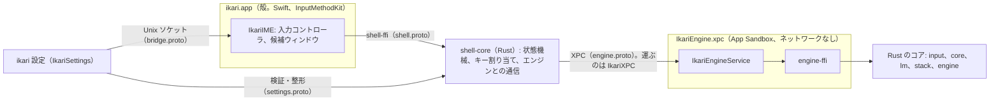
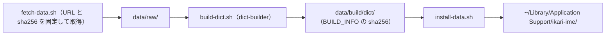

# 機能一覧

ikari-ime が今できること、まだできないこと、それぞれを決めた判断（ADR）をまとめる。初めて読む利用者と開発者が、全体の見取り図として使うことを想定している。

- 基準日: 2026-10-25（main の状態）
- 何をしたいか（要件）は [要件定義書](ikari-ime_spec.md)、今の構成は [architecture.md](architecture.md)、判断の経緯は [ADR の索引](adr/README.md) にある。
- 各項目の ADR 番号は、その機能を決めた判断の記録。状態（承認・提案など）は ADR の先頭で確かめられる。

## 状態の見方

| 状態 | 意味 |
| --- | --- |
| 実装済み | コードにあり、既定の動きが決まっている。コードと既定値、関係する ADR の状態で確かめた |
| 一部 | 一部だけある。残りは補足に書く |
| 予定 | ADR で決めたが、まだ作っていない |
| 検討中 | 試している、または方針が決まっていない。停止した案もここに入れ、理由を補足に書く |
| 要確認 | コードや ADR だけでは確かめられなかった。実機または作者の確認が要る（今は該当なし） |

「実装済み」は、実機で動作を通して確かめたという意味ではない。実機での確認が残るものは補足に書く。

---

## 利用者向け

### 変換と候補

| 機能 | 状態 | ADR | 補足 |
| --- | --- | --- | --- |
| 読みから候補を出す（読みに完全一致する語。読みを分けて一致させる語も含む） | 実装済み | [0001](adr/0001-phase0-architecture.md)、[0002](adr/0002-phase1-architecture.md) | 辞書は SudachiDict を母体にする。候補は辞書から作り、LM は並べ替えにだけ使う |
| 候補ウィンドウ（縦一列。最初は 3 件、3 件目の次で 9 件に広がる。数字キーで選ぶ） | 実装済み | [0014](adr/0014-candidate-window-layout.md) | 最初に見せる件数は設定 `paging.size`（1〜9、既定 3）。最後のページの次の動きは `paging.wrap` で決める |
| 確定履歴による文脈つきの順位付け | 実装済み | [0002](adr/0002-phase1-architecture.md)、[0015](adr/0015-context-sources.md) | 同じ入力欄で確定した語を左文脈に使う。どのアプリでも使える |
| 入力欄の周辺テキストを文脈に使う | 一部 | [0015](adr/0015-context-sources.md) | 殻が、カーソルの左の末尾 2000 字と右の先頭 2000 字を取ってエンジンに渡す。LM が見るのは左の末尾 40 字だけで、右は渡すが順位づけにはまだ使っていない |
| 文書内で出た語を加点する（文書内キャッシュ） | 実装済み | [0002](adr/0002-phase1-architecture.md) | 周辺・確定履歴にすでに出ている語を優先する |
| 話題スコア（単語ベクトルと小型 LM で同音語を選び分ける） | 実装済み | [0003](adr/0003-topic-ranker-decision.md) | 単語ベクトルは chiVe（Word2Vec）、LM は zenz small |
| 表記の既定（公用文の書き表し方） | 実装済み | [0009](adr/0009-verb-notation.md)、[0011](adr/0011-compound-over-affix-split.md)、[0017](adr/0017-formal-noun-kanji-bonus-scope.md) | 異字同訓の表（`kun.tsv`）の中身は作者の確認待ち |
| 辞書の新語（IT の語彙集、SudachiDict Full との差分） | 実装済み | [0012](adr/0012-new-word-dictionary.md) | IT の語彙集は同梱。設定 `dict.pack_it`（既定 on） |
| カタカナ語の綴り（英字）の並べ方 | 実装済み | [0020](adr/0020-english-spelling-first-candidate.md) | 並べ方の規則は ADR に従う |
| 機能語（の・は・とする など）はひらがなのままを 1 位にする | 一部 | spec FR-05 | 「の」「は」単独や「ここのは」はひらがなが 1 位（CLI で確認）。ただしこの要件を直接実装した専用の規則はなく、辞書の順位と、助詞と非自立動詞の組を内容語の加点が覆さない文法ガードによる |
| 数字の変換（1234 → 1,234、千二百三十四、１２３４） | 実装済み | [0002](adr/0002-phase1-architecture.md) | 読みが数字のときに Rewriter が候補を足す |
| 注釈（同音語の説明を 2 行目に出す） | 予定 | [0014](adr/0014-candidate-window-layout.md) | 注釈のデータが入るまで行は出さない（§9） |

### 文節の編集

| 機能 | 状態 | ADR | 補足 |
| --- | --- | --- | --- |
| 文節の移動（← / →。既定） | 実装済み | [0006](adr/0006-segment-editing.md) | 変換中に、フォーカスする文節を移す |
| 文節の伸縮（Shift+← / Shift+→。既定） | 実装済み | [0006](adr/0006-segment-editing.md) | 文節の区切りの位置を 1 文字ずつ替える。その文節の候補だけを選び直す |
| 確定した文字列の再変換（既定 Ctrl+Shift+R） | 実装済み | [0006](adr/0006-segment-editing.md) | 確定した文字列を選んで、もう一度変換する |

### 学習

| 機能 | 状態 | ADR | 補足 |
| --- | --- | --- | --- |
| 文脈つきの学習（読み＋左文脈 → 選んだ語） | 実装済み | [0013](adr/0013-learning-without-context.md)、[0002](adr/0002-phase1-architecture.md)、[0057](adr/0057-learning-cap-human-over-lm.md) | 「最後に選んだ語を 1 位にする」だけの学習はしない。1 位以外を選んだ確定は強く（4 回分。同じ文脈なら 1 回で 1 位）、1 位のままの確定は弱く（1 回分）。忘却は半減期 90 日 |
| 同じ読みで直前に選んだ表記は、数分だけ優先する（保存しない） | 実装済み | [0045](adr/0045-recent-choice-bonus.md) | 長く選んだ別の表記があっても、直前に選んだものが 5 分の間は 1 位になる（窓を過ぎると戻る）。文脈が別の候補を支持するときは覆さない。同じ読みだけに効き、再起動で消える |
| 別の文脈での選択で、既存の学習を消さない | 実装済み | [0013](adr/0013-learning-without-context.md) | 文脈が記録にないときの効き方も 0013 で決めた |
| 学習のリセットとバックアップ | 実装済み | [0005](adr/0005-macos-settings-and-indicator.md) | リセットの前に、エンジンが自動でバックアップを書く |
| エクスポート／インポート（ユーザー辞書、学習データ） | 実装済み | [0002](adr/0002-phase1-architecture.md)、[0005](adr/0005-macos-settings-and-indicator.md) | インポートは既存データを上書きする（マージしない）。実行の前に件数を確かめる |
| 文章の取り込み（自分の文章から、表記の好みや同音語の選び方を学ぶ） | 一部 | [0002](adr/0002-phase1-architecture.md) §11 | CLI の取り込みコマンドだけ。画面と取り込み元の一覧は予定（フェーズ3） |
| 属性プロファイル（IT、インフラ、小説、ビジネスの分野の事前情報） | 実装済み | [0002](adr/0002-phase1-architecture.md) §21.1 | 設定アプリの「入力と変換」で、分野ごとに「使わない／たまに／よく」を選ぶ。エンジンと CLI にもある |

### LM による並べ替え

| 機能 | 状態 | ADR | 補足 |
| --- | --- | --- | --- |
| zenz（GGUF、llama.cpp。Metal で動かす）による並べ替え | 実装済み | [0003](adr/0003-topic-ranker-decision.md) | LM は並べ替えにだけ使い、候補は増やさない |
| 規則で守った 1 位を、LM が覆さない | 実装済み | [0024](adr/0024-lm-keeps-rule-s.md) | 規則 S（名詞＋する など）の判定を最後の段で戻す |
| 待ち時間の上限（Space から最大 30 ms。間に合わなければ LM なしで出す） | 実装済み | [0021](adr/0021-lm-lookahead.md) | 先行計算もある。間に合った割合は測定で確かめている |
| 設定 `engine.lm`（既定 on）で LM を止める | 実装済み | [0003](adr/0003-topic-ranker-decision.md) | 止めると辞書とコストだけで並べる。LM がないときも変換は続く |
| 次の語を予測して並べ替える、LM で先読みの文を作る | 検討中（停止） | [0023](adr/0023-speculative-cache-stage1-2.md)、[0025](adr/0025-pregen-prototype.md) | 0025 の試作は、結果から停止した（§13） |
| LM の事前の好みを差し引く | 検討中（停止） | [0028](adr/0028-lm-prior-subtraction.md) | 評価で悪化したため停止（§11） |
| ほかのモデルを足す、替える | 検討中 | [0003](adr/0003-topic-ranker-decision.md) | 足す・替えるときは ADR で実測してから決める |

### 入力配列とキー

| 機能 | 状態 | ADR | 補足 |
| --- | --- | --- | --- |
| ローマ字入力（既定の表は [romaji.tsv](../input/assets/romaji.tsv)） | 実装済み | [0004](adr/0004-phase2-macos.md) §3.3 | 表はファイルで編集できる。利用者の表は既定の表を丸ごと置き換える |
| JIS かな入力 | 実装済み | [0004](adr/0004-phase2-macos.md) §3.3 | かなキーの位置で打つ |
| z＋キーで記号（zh → ←、zj → ↓、zk → ↑、zl → →、z. → … など） | 実装済み | [0002](adr/0002-phase1-architecture.md) §12 | 記号の表は [symbols.tsv](../core/assets/symbols.tsv)。かな入力では使えない |
| 大西配列、薙刀式などのキーの入れ替え・同時打鍵 | 予定 | [0031](adr/0031-keymap-engine.md) | 第 1 段階（キーの入れ替え）は hidutil。第 2 段階以降は常駐のエンジンが要る。OS のレベルで効かせる |
| キーボードごとに配列を切り替える | 検討中 | [0031](adr/0031-keymap-engine.md) §2（D6） | 第 1 段階で、キーボードごとの指定が効くかを確かめる |

### ショートカット

| 機能 | 状態 | ADR | 補足 |
| --- | --- | --- | --- |
| キー割り当てのプリセット（`keymap.preset`：`macos`、`ms-ime`、`atok`） | 実装済み | [0004](adr/0004-phase2-macos.md) §6.3、[契約](phase2-contract.md) §4 | 操作ごとに上書きできる（`keymap.<操作>`）。プリセットは [macos.tsv](../macos/Resources/keymap/macos.tsv)、[ms-ime.tsv](../macos/Resources/keymap/ms-ime.tsv)、[atok.tsv](../macos/Resources/keymap/atok.tsv)（ATOK 風。#62。MS-IME 風を土台に、半角英数が Ctrl+@、再変換が Ctrl+Shift+Y。ATOK だけの操作は含めない） |
| 字種変換（F6 ひらがな、F7 全角カタカナ、F8 半角カタカナ、F9 全角英数、F10 半角英数） | 実装済み | [0004](adr/0004-phase2-macos.md) §6.3 | 割り当てはプリセットで変えられる。F6〜F10 のないキーボードには別のキーを割り当てる |
| 入力モードの切り替え（`mode.toggle`、`mode.english`、`mode.japanese`） | 実装済み | [0026](adr/0026-english-mode-and-key-stats.md) §5.3 | 既定では割り当てなし。英数キー・かなキーは macOS の切り替えに任せる |
| 定型文（テンプレート） | 予定 | spec「基本原則」（柱 3） | ADR はまだない |

### 英語のモード

| 機能 | 状態 | ADR | 補足 |
| --- | --- | --- | --- |
| 英語のモード（英数キーで入る。打鍵をそのままアプリに渡す） | 実装済み | [0026](adr/0026-english-mode-and-key-stats.md) | 英語のモードでは変換しない。ABC の入力ソースも残す |
| 英語の文脈（区切りまで溜めて、確定履歴に入れる。学習はしない） | 実装済み | [0026](adr/0026-english-mode-and-key-stats.md) §5.5 | 区切りは Return、Tab、矢印、修飾キー付きの打鍵、モードの切り替えなど |
| 英語のモードでの郵便番号の候補 | 予定 | [0032](adr/0032-postal-code.md) §9 | 設定 `postal.english`（既定 off）は読むだけ。実装は後の段階 |

### 絵文字

| 機能 | 状態 | ADR | 補足 |
| --- | --- | --- | --- |
| ショートコード（`:eyes:` と打って閉じると 👀 が候補に出る） | 実装済み | [0027](adr/0027-emoji-input.md) | 既定はオフ（設定 `emoji.shortcode`）。頭の `:` から入り、閉じる `:` で候補になる。日本語のモードと英語のモードの両方で動く。除外アプリとパスワード欄では動かない |
| 名前の表（Slack と同じ名前。emoji-data が元） | 実装済み | [0027](adr/0027-emoji-input.md) §5 | 元データは `scripts/fetch-data.sh` で取る（通信する） |
| 小さい文字で出す（設定 `emoji.small_letters`） | 実装済み | [0027](adr/0027-emoji-input.md) | 既定はオフ |
| 読みの完全一致で絵文字・顔文字を出す（「かお」→ 顔文字 など） | 一部 | spec「便利な変換」 | 数が少ない。表は [emoticons.tsv](../core/assets/emoticons.tsv) |
| 絵文字パレット（文字ビューアを開いて選ぶ） | 検討中 | [0027](adr/0027-emoji-input.md) §6.2、§10 | 変換中の Ctrl+Cmd+Space では文字ビューアが開かない。直し方を試している |
| 読みから絵文字を出す（「め」→ 👀 など） | 予定 | [0027](adr/0027-emoji-input.md) §14 | 段階 2。候補の位置は 3 件目以降 |

### 日付・数字・計算

| 機能 | 状態 | ADR | 補足 |
| --- | --- | --- | --- |
| 今日・明日・昨日・今年などの日付（「きょう」→ 2026/10/25 など） | 実装済み | [0002](adr/0002-phase1-architecture.md) §12 | 日付の書式の候補。辞書の候補より後ろに出す |
| 和暦（「れいわ8ねん」→ 2026年、「2011ねん」→ 平成23年） | 実装済み | [0002](adr/0002-phase1-architecture.md) §12 | 年だけを扱う |
| 電卓（「1+2=」→ 3） | 実装済み | [0002](adr/0002-phase1-architecture.md) §12 | 四則演算 |
| Unicode 表記（「あ」→ U+3042。設定 `unicode.notation`、既定 off） | 実装済み | [0002](adr/0002-phase1-architecture.md) §12 | 読みが 1 文字のひらがなのときだけ |

### 地名・郵便番号

地名と郵便番号のデータは、デジタル庁の ABR（町字マスター、町字・郵便番号変換表）から作る。データは利用者が `scripts/fetch-data.sh` で取り、辞書をビルドするときに使う。データがなければ、この機能は働かない。

| 機能 | 状態 | ADR | 補足 |
| --- | --- | --- | --- |
| 地名の語彙（都道府県、市区町村、町名を辞書に足す） | 実装済み | [0030](adr/0030-abr-town-vocabulary.md) | データを取って辞書をビルドしたときに入る |
| 住所の連なりの変換（読み全体が「都道府県＋郡＋市区＋町名」に一致したら、その表記を 1 位にする） | 実装済み | [0030](adr/0030-abr-town-vocabulary.md) §12 | 同じ行の辞書の語より優先する |
| 住所 ↔ 郵便番号（読みが郵便番号の形、または住所の連なりのとき候補を足す） | 実装済み | [0032](adr/0032-postal-code.md) | 設定 `postal.japanese`（既定 on） |
| 〒つきの候補（「て」＋郵便番号） | 実装済み | [0032](adr/0032-postal-code.md) §8 | 設定 `postal.te_prefix`（既定 off） |
| 地名データの配布と自動更新 | 検討中 | [0033](adr/0033-place-data-distribution.md) | 提案の段階。決まるまでは手動で取る |

### 設定アプリ「ikari 設定」

| 機能 | 状態 | ADR | 補足 |
| --- | --- | --- | --- |
| 画面（入力、変換、ユーザー辞書、学習とデータ、このソフトについて） | 実装済み | [0005](adr/0005-macos-settings-and-indicator.md) §15.1 | 設定の中身は `settings.tsv`（キーと値のタブ区切り。[0005](adr/0005-macos-settings-and-indicator.md) §7.1） |
| 入力メニュー（ON/OFF の表示、入力モードの切り替え） | 実装済み | [0005](adr/0005-macos-settings-and-indicator.md) | 独自のモード表示は持たない（[macos/README.md](../macos/README.md)） |
| ユーザー辞書の追加・削除（品詞、活用の型を指定する） | 実装済み | [0005](adr/0005-macos-settings-and-indicator.md) | 品詞は簡略化して出す |
| 文章の取り込みの画面、取り込み元の一覧 | 予定 | [0002](adr/0002-phase1-architecture.md) §11 | フェーズ3 |
| 属性プロファイルの画面 | 実装済み | [0002](adr/0002-phase1-architecture.md) §21.1 | 設定アプリの「入力と変換」 |

### 作らないこと

ikari-ime は次の機能を作らない（[要件定義書](ikari-ime_spec.md) の基本原則による）。

- ライブ変換（打つたびに変換する）
- 次の語の予測、入力途中のサジェスト
- 確定後のアンドゥ
- 入力の補完（ユーザーが選ばずに文字を足すこと）。入力の結果を変える機能（ショートコードや括弧の補完など）は、既定でオフにする

### プライバシーと安全

| 機能 | 状態 | ADR | 補足 |
| --- | --- | --- | --- |
| 変換と入力の部分は外部と通信しない | 実装済み | [0004](adr/0004-phase2-macos.md)、spec NFR-17 | 殻とエンジンは App Sandbox で動き、ネットワークの権限を持たない（ビルド時に確かめる）。通信は `fetch-data.sh` を利用者が実行したときと、初回の SwiftPM の取得だけ |
| パスワード欄（secure input）では、文脈も学習も確定履歴も使わない | 実装済み | [0004](adr/0004-phase2-macos.md)、[0026](adr/0026-english-mode-and-key-stats.md) §3 | 英語のモードでも素通しにし、何も記録しない（spec NFR-18） |
| 学習データに文章の生テキストを残さない | 実装済み | spec NFR-19、[0013](adr/0013-learning-without-context.md) | 保存するのは、（読み、表記、文脈の特徴量のハッシュ）ごとの回数。左の文脈の生テキストは持たない。確定した候補（読みが一定の長さ以下）の文は残りうる |
| 診断ログ（エンジンのログ。文字は書かない。secure では何も書かない） | 実装済み | [0034](adr/0034-diagnostic-log.md) | 保持は 180 日または 100 MB のどちらか先まで。古いものから消す。場所はユーザーデータの `logs/` |
| 入力の統計（打鍵と確定した文字の回数） | 予定 | [0026](adr/0026-english-mode-and-key-stats.md) §6 | 既定はオフで、オンにするには 2 つのスイッチがいる。まだ作られていない |
| アクセシビリティの権限 | 実装済み（任意） | [0004](adr/0004-phase2-macos.md)、[0014](adr/0014-candidate-window-layout.md) | 候補ウィンドウの位置を、入力欄から取れないときの代わりに使う。権限は求めず、許可されているときだけ使う。文脈の取得には使わない |

### 動作環境

| 環境 | 状態 | 補足 |
| --- | --- | --- |
| macOS（Apple Silicon） | 実装済み | Xcode 27 / Swift 6.4、Rust（`aarch64-apple-darwin`）。LM を使うときは cmake も要る。手順は [README](../README.md#5-インストールソースからのビルド) |
| Windows（TSF）、Linux（Fcitx5） | 予定 | spec「OS 別の実装メモ」。macOS の後の段階 |
| iOS、Android | 予定 | 別のプロジェクトとして作る（spec「スコープとロードマップ」） |

---

## 開発者向け

### 全体の構成



構成の詳細（crate の依存、プロセス、データの置き場所）は [architecture.md](architecture.md) が正。

### Rust のコア

| crate | 役割 | ADR |
| --- | --- | --- |
| `dict-format` | バイナリ辞書の形式（`grammar.bin`、`system.dict`、`vectors.bin`）と検証、読みの正規化 | [0001](adr/0001-phase0-architecture.md) §3、[0002](adr/0002-phase1-architecture.md) §3 |
| `dict-builder` | SudachiDict と chiVe から辞書を作る。`policy/*.tsv` でコストを調整する | [0001](adr/0001-phase0-architecture.md) §8、[0002](adr/0002-phase1-architecture.md) §4 |
| `input` | ローマ字、JIS かな、字種変換。辞書に依存しない | [0004](adr/0004-phase2-macos.md) §3.3 |
| `core` | 辞書引き、ラティスと Viterbi、Ranker（コスト、左文脈、文書内キャッシュ、学習、話題、規則の Guard）、Rewriter（日付、数字、電卓、記号、絵文字、郵便番号など）、文節の編集、ユーザーデータ | [0001](adr/0001-phase0-architecture.md)、[0002](adr/0002-phase1-architecture.md)、[0006](adr/0006-segment-editing.md)、[0024](adr/0024-lm-keeps-rule-s.md) |
| `lm` | zenz（GGUF、llama.cpp）による話題スコア。feature `llama`、`metal` のときだけ llama.cpp をビルドする | [0003](adr/0003-topic-ranker-decision.md) |
| `stack` | Converter、Ranker、LM の組み立てを 1 か所にまとめる（エンジン、CLI、eval が使う） | [0004](adr/0004-phase2-macos.md) §3.2 |
| `shell-core` | 殻の OS に依存しない処理（入力の状態機械、キー割り当て、英語のモードの文脈、ショートコード、配置の計算、エンジンとの通信、設定の検証）。`shell-ffi` が C ABI を出す | [0041](adr/0041-shell-state-machine-in-rust.md) |
| `import` | 取り込みファイル（JSONL）の検証、強制アライメント、初期学習 | [0002](adr/0002-phase1-architecture.md) §11 |

Ranker は差し替え可能な trait として作る。実装方式（Word2Vec か小型 LM か）をコアに埋め込まない（spec「依頼するときの原則」）。

### 常駐エンジン（engine）

- 殻からの `Envelope` を受けて返す。セッション、変換、文節、管理（ユーザー辞書、学習、エクスポート、インポート）、データの監視、裏のスレッド、診断ログを持つ（[0004](adr/0004-phase2-macos.md) §7）。
- データのフォルダは `engine.lock` を flock で持つ。CLI の学習ファイルの書き込みとの排他に使う（[0004](adr/0004-phase2-macos.md) §7.4）。
- secure のセッションでは、文脈を読まず、学習せず、履歴を残さない（`engine/src/convert.rs`、`session.rs`）。
- `engine-ffi` が C ABI を出し、XPC サービスの Swift がそれを呼ぶ。

### macOS の殻

| モジュール | 役割 |
| --- | --- |
| `IkariIME` | IMKServer、入力コントローラ、候補ウィンドウ。判断は持たず、`shell-core` に渡して動作の列を実行する |
| `IkariShellABI` | `shell-ffi` の薄い層と、キーコードの表 |
| `IkariXPC` | エンジンへの XPC 接続（輸送）。署名要件で相手を確かめる |
| `IkariBridge` | 設定アプリとの Unix ソケット（輸送） |
| `IkariSettings` | 設定アプリ（SwiftUI）。エンジンには直接つながない。検証と整形は `shell-core` |
| `IkariSmoke` | 実機の E2E（後述） |

詳しくは [macos/README.md](../macos/README.md)。

### proto の契約

- [`engine.proto`](../proto/ikari/engine/v1/engine.proto)：殻とエンジンの間のメッセージ（Rust は prost、Swift は SwiftProtobuf で生成する）。スキーマのバージョンで互換性を管理する。殻はエンジンの版が違うと起こし直す（[0004](adr/0004-phase2-macos.md) §5）。
- [`bridge.proto`](../proto/ikari/bridge/v1/bridge.proto)：設定アプリと殻の間（殻の側は `shell-core` が読む）。
- 契約の詳細（識別子、署名要件、上限）は [phase2-contract.md](phase2-contract.md)。

### 辞書のビルド



- 入力の sha256 が `BUILD_INFO` と同じなら、辞書は作り直さない。
- 語彙（地名、新語、IT の語彙集）と、コストの調整（`policy/*.tsv`）は [0012](adr/0012-new-word-dictionary.md)、[0030](adr/0030-abr-town-vocabulary.md)、[0035](adr/0035-path-loses-cost-adjust.md) などで決めた。
- 元データのライセンスは [THIRD_PARTY_NOTICES.md](../THIRD_PARTY_NOTICES.md) にある。

### 評価（ikari-eval）

- 評価セットは [eval/sets/](../eval/sets/)、結果のレポートと索引は [eval/reports/README.md](../eval/reports/README.md)。
- `ikari-eval` は、評価セットを流して正解率（全体と種別）、平均逆順位、応答時間を出す。終了コードは 0 が成功、1 が基準未達、2 が実行不能。
- 変換のコードに手を入れたら、既存の全セットで 1 位が悪化していないことを確かめる。振る舞いの一致は `eval/scripts/snapshot.sh` で見る。
- 評価の仕組みは [0001](adr/0001-phase0-architecture.md) §6、[0002](adr/0002-phase1-architecture.md) §15 にある。

### 診断ログ

- エンジンのログは `logs/engine.log` に書く。書き込みは専用のスレッドで行い、満杯のときは捨てて件数だけ残す。
- 殻の事象は片道のメッセージ（`DiagEvent`）で送る。合成 1 回を `sh_episode` 1 行にまとめる。
- 日ごとの集計は [scripts/diag-report.py](../scripts/diag-report.py) で出す。
- 判断は [0034](adr/0034-diagnostic-log.md)。文字や読みは書かない（NFR-19）。

### 実機の確かめ（smoke）

- [macos/scripts/smoke.sh](../macos/scripts/smoke.sh) は、バンドルの中から XPC 経由で E2E を流す。変換、文脈、確定、エンジンの kill からの復帰、版の不一致、打鍵の時間（p99）、ユーザー辞書、文節と再変換を確かめる。
- 利用中の IME がエンジンのロックを持っているとき、smoke は「実行できない」で終わる（終了コード 2）。
- smoke は実機の学習を汚さないように、secure のセッションで文節の確認をする（[macos/README.md](../macos/README.md)）。

### 検査（scripts/check.sh）

```sh
scripts/check.sh              # 文書のリンク、fmt、clippy、cargo test、swift test
scripts/check.sh --lm         # LM つき（llama.cpp をビルド。cmake が要る）
scripts/check.sh --real       # 実データの #[ignore] テスト（辞書とモデルが要る）
scripts/check.sh --perf       # 性能のテスト（release）
scripts/check.sh --eval <基準のディレクトリ>   # 振る舞いの一致を確かめる
```

### ADR の運用

- 判断の記録は [docs/adr/](adr/README.md)。番号は連番、ファイル名は `NNNN-タイトル.md`。
- 状態は `提案` / `承認` / `一部置き換え（ADR XXXX §n）` / `置き換え（ADR XXXX）` のどれか。索引と本文の先頭の語が一致しているかは `scripts/check.sh` が確かめる。
- 決定を変えるときは、古い ADR を書き換えず、新しい ADR を書いて置き換える（一部だけなら「一部置き換え」）。

### 予定と検討中の作業の所在

| 項目 | 参照する ADR |
| --- | --- |
| キーマップ（大西配列、薙刀式）の第 1 段階と、それ以降 | [0031](adr/0031-keymap-engine.md) |
| 絵文字パレット、読みからの絵文字 | [0027](adr/0027-emoji-input.md) |
| 英語のモードの統計 | [0026](adr/0026-english-mode-and-key-stats.md) |
| 地名データの配布 | [0033](adr/0033-place-data-distribution.md) |
| 次の語の予測、先読みの生成（停止中） | [0023](adr/0023-speculative-cache-stage1-2.md)、[0025](adr/0025-pregen-prototype.md) |
