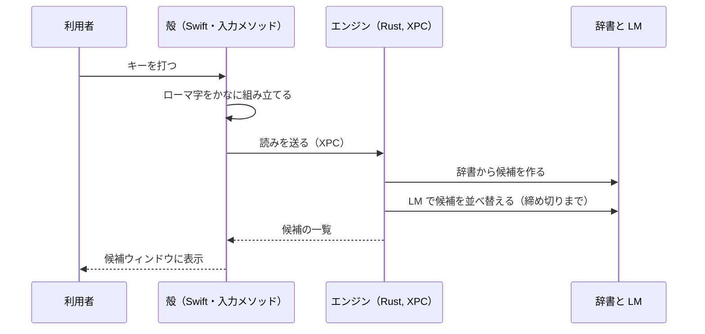
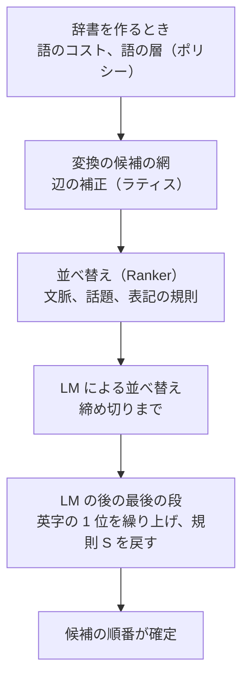

# 設計の大きな選択と、ADR の索引

この文書は、ikari の設計で大きな選択を 10 個にまとめ、そのあとに ADR（設計判断の記録）の一覧を載せたものです。どの選択も、「何を決めたか」「なぜ」「やめた案」の順に書いています。

- 年表の流れは [README.md](README.md) を見てください。
- 指摘を受けて方針が変わった例や、覆った仮説は [lessons.md](lessons.md) にあります。

## 大きな選択 10 個

### 1. 入力を正とする（補完はしない）

- **決めたこと**: ユーザーが入力していない文字は、候補に足さない。読みに対応しない表記は出さない。
- **なぜ**: 変換は、ユーザーの意図を形にするためのものです。打っていない「〜」や「YO」が勝手に付くと、確定した文字を直す手間が増えます。
- **やめた案**: 入力していない記号を候補の後ろに回す案。後ろに回しても、選ばれれば入力にないものが入るため、「出さない」に決めました（[user-feedback](../user-feedback.md) の 1.1）。
- **失ったもの**: 予測変換のような、先回りの便利さは出しません。速さは、次の選択 5 のとおり、配列とショートカットで出します。
- **根拠**: [spec](../ikari-ime_spec.md) の基本原則。[ADR 0002](../adr/0002-phase1-architecture.md) で、辞書の行は消さずにペナルティで後ろに回すことにしました。

### 2. 候補は辞書から作り、LM は並べ替えにだけ使う

- **決めたこと**: 候補の中身は辞書が決めます。LM（zenz）は、辞書の候補の中で順番を変えるだけに使います。
- **なぜ**: LM に読みから文字列を作らせると、読みと合わない表記が出ることがあるためです。LM が使えないときも、辞書の候補で動くようにしています（[ADR 0003](../adr/0003-topic-ranker-decision.md)）。
- **やめた案**: LM に読みから候補を作らせて足す案（取り下げ。[user-feedback](../user-feedback.md) の 1.3）。「一致したら保存した表記を 1 位に出す」完全一致のキャッシュ（測って不採用。[ADR 0023](../adr/0023-speculative-cache-stage1-2.md)）。
- **失ったもの**: 長い入力では、正解が辞書の候補に入らないことがあります。AJIMEE の評価では約 40% で、正解が最初の並べ替えの対象の外か、候補にありませんでした（ADR 0023 の測定）。長文は、ikari の目指す「こまめに確定する」の外として扱っています。

### 3. LM は 1 つにする。短い確定を前提にする

- **決めたこと**: LM は zenz-v3.2 small の 1 つだけを使います。長文向けに別のモデルで使い分ける案は採りません。ただし、英語が混じる文脈など、今のモデルで効かない場面が測れたら、モデルを足す案は検討します（この余地は残します）。
- **なぜ**: ikari は、短い単位でこまめに確定するのが前提です。仕組みを複雑にするのは、長文のためになるからです。
- **やめた案**: 長文向けの xsmall との併用（[ADR 0003](../adr/0003-topic-ranker-decision.md) §7.1-1 で取り下げ）。
- **失ったもの**: 長文の精度は、この設計では上がりにくいです。

### 4. 学習は支援であって、決定ではない

- **決めたこと**: 学習で覚えた選択は、いまの文脈の判断を覆しません。文脈の記録がない入力のときだけ、その読みで選んできた表記に戻ってよいとしました。
- **なぜ**: 「品詞」を技術の文章で何度選んでも、「兵士は瀕死」の文脈では「瀕死」のままであるべきだからです（[user-feedback](../user-feedback.md) の 1.2）。
- **やめた案**: 直前に選んだ表記を、文脈によらず 1 位にする短い記憶。測ったところ、正しい入れ替えも誤った入れ替えも増えました（r-ext で +42 −15 など）。基本原則にも反するため、採りませんでした（[ADR 0013](../adr/0013-learning-without-context.md) の案 E）。
- **失ったもの**: 文脈のない入力では、1 回選んだだけでは直りません。「なおったけど」は「治った」のままになる、と測定で分かっています（[ADR 0013](../adr/0013-learning-without-context.md)、[user-feedback](../user-feedback.md) の 2 節）。

### 5. 速さは、補完ではなく入力配列とショートカットで出す

- **決めたこと**: 少ない打鍵で速く入れたい要求には、入力配列の変更とショートカットで応えます。予測変換やサジェストは取り入れません。方針は 2026-10-20 に、3 本柱の 1 つとして決めました。
- **なぜ**: 補完は、入力していない文字を足すことになり、「入力を正とする」に反します。配列は、ユーザーが選んで使うものです。
- **やめた案**: 入力メソッドの中で配列を処理する案（パスワード欄で効かず、keyUp も届かないと実測）。仮想キーボード（権限が要り、権限のある形でも OS に終了させられたと実測）。Karabiner（方針で使わない）。[ADR 0031](../adr/0031-keymap-engine.md) で、キーの入れ替えは hidutil、薙刀式などは別の常駐プログラムで行うと決めました。
- **失ったもの**: 配列の処理は、IME の外の常駐プログラムに分けるので、動かす部品が増えます。

### 6. 構成は、Rust の変換エンジン、常駐のエンジンプロセス、Swift の殻の 3 つ

- **決めたこと**: 入力メソッドの殻（Swift）の中に、変換エンジン（Rust）を XPC サービスとして同梱します。殻とエンジンの境界は、C の関数の形（C ABI）と protobuf にします。ローマ字からかなへの組み立ては殻が行います。
- **なぜ**: エンジンが落ちても、殻は入力を止めません（NFR-16）。打鍵のたびに通信を走らせないためです（[ADR 0004](../adr/0004-phase2-macos.md)）。
- **やめた案**: IMKCandidates（横一列、番号の固定など、必要な配置が作れない）。ローマ字の組み立てをエンジン側で行う案（打鍵のたびに通信し、エンジンが落ちると入力も止まる）。辞書とモデルをアプリに同梱する案（約 340MB になり、更新で入れ替えられない）。
- **失ったもの**: 候補ウィンドウは自分で作ります。殻とエンジンの 2 つのプロセスを、署名やインストールで管理します。

### 7. 辞書は大きいものを使い、行は消さずにペナルティで後ろに回す

- **決めたこと**: 辞書は SudachiDict をもとにし、語を消す代わりに、ペナルティで後ろに回します。新語は別の層として足し、IT の語は手で作った語彙集で足します。地名は、ABR の町字マスターから大字と町名だけを足します。
- **なぜ**: 文脈の解析では、表記ゆれや数字の語も必要になるため、行を消すと解析が崩れます（[ADR 0002](../adr/0002-phase1-architecture.md) の §5）。熟語の誤りは、辞書に 1 語で入っているのに分割に負ける型でした（[ADR 0011](../adr/0011-compound-over-affix-split.md)）。
- **やめた案**: 外部の辞書を足す案（更新が止まっている、品詞が合わない、ライセンスの問題）。英字の表記を一律に上げる案（一般の英単語まで上がる）。地名は、小字（約 52 万行）と通り名を入れない（[ADR 0030](../adr/0030-abr-town-vocabulary.md)）。
- **注意**: [ADR 0012](../adr/0012-new-word-dictionary.md) の前半は当初の「Full の差分を層として足す案 A」を書いていますが、§11.3（2026-10-14 の最終決定）で「Full に置き換える」に置き換わっています（ADR の冒頭と該当の箇所に注記済み）。実際の構成は §11.3 です。
- **失ったもの**: 辞書が大きくなり、起動直後の最初の変換が遅くなります（[ADR 0012](../adr/0012-new-word-dictionary.md) の §3.4.1 の測定）。ユーザー辞書の語の重さも、辞書の作り替えで変わります。

### 8. 文脈は広く読むが、保存はしない

- **決めたこと**: 同じ入力欄の履歴は切らずに使います。他のアプリの文脈は、同じ入力欄に何もないときだけ借ります。文脈は、保存しません。
- **なぜ**: 直前の文脈を捨てると、精度が 38 ポイント落ちると測れたためです（[ADR 0015](../adr/0015-context-sources.md)）。一方、文の長さを 40 字から 160 字に伸ばすと、無関係な文が害になり、950 から 888 に下がりました。
- **やめた案**: 履歴をディスクに保存する案（原文を持たない、という方針に反する）。アクセシビリティ API で入力欄の全文を読む案（権限が要り、Chrome では重くなる）。全アプリの文脈を 1 本の履歴にする案（無関係な文がつながる）。
- **失ったもの**: VS Code や Chrome のように、カーソルの位置が当てにならないアプリでは、前の確定の文脈を正しく判定できないことがあります（[ADR 0015](../adr/0015-context-sources.md) の H-B'）。

### 9. 最初の Space は、読み全体の候補を出す

- **決めたこと**: 最初の Space は、読み全体の候補を出します。←/→ や Shift+←/→ を押したときだけ、文節のモードに入ります。文節ごとの候補は、その文節の読みだけで作り直します。
- **なぜ**: 最初から文節のモードにすると、2 文節の入力で数字キーが使えず、打鍵が増えると分かったためです（[ADR 0006](../adr/0006-segment-editing.md)、[user-feedback](../user-feedback.md) の 3 節）。
- **やめた案**: 選択がないときに、直前の語を自動で選んで直す案（ユーザーの意図を推測することになる）。文全体で候補を並べ直す案（出力の長さが読み全体になり、候補の数だけ採点が要る）。
- **失ったもの**: 文節だけを直したいときは、←/→ の一手が要ります。

### 10. 直すのは、原因を測ってから、最も狭い層で

- **決めたこと**: 誤変換は、原因ごとに分けて測ってから直します。規則は、辞書の作り方、候補の網の辺、並べ替え、LM の後の最後の段、のうち最も狭い層に足します。全評価セットで 1 位の悪化がないことを条件にします。直さないと決めた例も、記録に残します。
- **なぜ**: 1 つの規則が、正しい入力を別の形で壊すことが多かったためです。たとえば「さいかい → 最下位」の試作は、どの案でも、「最下位」が正しい文を崩しました（文のある 18 件で 12 件 → 6〜10 件）。
- **やめた案**: LM の重みを下げる案（防げる 14 件に対し、LM が直す 52 件を失い、正味 −38）。熟語の上限を上げるだけの案（伊富魚、総指揮などが崩れる）。

## ADR の索引

ADR は、判断の時点の記録です。後から変わった判断は「一部置き換え」「置き換え」「停止」と状態に書かれています。以下は、各 ADR の「決めたこと」「なぜ」「やめた案」を 2〜3 行にまとめたものです。詳しくは各 ADR を見てください。状態は、[ADR の索引](../adr/README.md)の表に従っています。

### 初期（2026-10-11〜10-12）

**[0001](../adr/0001-phase0-architecture.md) フェーズ0の構成と部品の契約**（承認、2026-10-11）
- 決めたこと: 辞書の形式を、変換側と辞書の作成道具の両方が使う独立の部品に分けた。
- なぜ: 辞書の更新の道具が、変換のコードを丸ごと抱えないため。並行で作っても衝突しないため。
- やめた案: 形式を変換側に置く、crawdad（ゼロコピーにできない）、連接表を辞書に同梱（71MB を複製する）、ジェネリクス（型引数が CLI まで広がる）。

**[0002](../adr/0002-phase1-architecture.md) フェーズ1の構成**（承認、2026-10-11）
- 決めたこと: 辞書の行は消さずに `ime_penalty` を付けて後ろに回す。文脈の解析は自前の辞書と Viterbi で行う。ユーザー辞書は Mozc 互換の 4 列 TSV にする。
- なぜ: 入力を正とするため、選択肢を消さない。解析には Sudachi の解析用のコストをそのまま使える。
- やめた案: sudachi.rs で解析する、学習を SQLite に保存する、candle で zenz を動かす（GGUF の扱いを自分で検証する必要がある）。

**[0003](../adr/0003-topic-ranker-decision.md) 話題の情報と LM の既定構成**（承認、2026-10-11）
- 決めたこと: 話題の情報（chiVe）と LM（zenz）を組み合わせる。のちに LM は small の 1 つだけにした（§7.1-1）。
- なぜ: 評価セット（ext test、181 件）で、話題の情報ありの LM は 76.2%、なしは 65.7%。
- やめた案: xsmall だけ（71.3%）、話題の情報なしの LM だけ（65.7%）。

**[0004](../adr/0004-phase2-macos.md) macOS 版の構成**（承認 2026-10-11、実装 2026-10-12）
- 決めたこと: 入力メソッドの殻の中に、XPC サービスとしてエンジンを同梱する。境界は C ABI と protobuf。ローマ字からかなへの組み立ては殻で行う。
- なぜ: エンジンが落ちても入力を止めない（NFR-16）。打鍵のたびに IPC を走らせない。
- やめた案: Mach サービスとして登録、UniFFI、IMKCandidates、殻も Sandbox に入れる、辞書とモデルのバンドル（約 340MB）。

**[0005](../adr/0005-macos-settings-and-indicator.md) ON/OFF の表示、メニュー、設定アプリ、辞書の管理**（承認、2026-10-12）
- 決めたこと: 設定は別のアプリにし、殻が中継してエンジンへ渡す。ON/OFF は入力メニューとアイコンで示す。
- なぜ: 入力メソッドの中で設定画面を開くと、開いた瞬間に、入力中の文字が確定されてしまう。
- やめた案: 入力メソッドの中で設定画面を開く、アイコンの形を変える、色で分ける（テンプレート画像は色を付けられない）。英数モードは持たない（のちに [0026](../adr/0026-english-mode-and-key-stats.md) で一部改めた）。

**[0006](../adr/0006-segment-editing.md) 文節の移動、区切り直し、確定後の再変換**（承認、2026-10-12）
- 決めたこと: 最初の Space は読み全体の候補。←/→ や Shift+←/→ を押したときだけ文節のモード。文節ごとの候補は、その文節だけの辞書の網から作り直す。
- なぜ: 短い確定では、直す文節は 1 つで、全体で確定するほうが打鍵が少ないと評価で分かったため。
- やめた案: 文全体で候補を並べ直す、選択がないときに直前の語を自動で選ぶ、区切り直しの前の選択を引き継ぐ。

### 誤変換の修正と試作（2026-10-13〜10-18）

**[0007](../adr/0007-left-context-compound.md) 左文脈の最後の語と複合語の加点**（承認、2026-10-13）
- 決めたこと: 直前の語と候補が 1 語の複合語になるとき、その候補に加点する（「自動 + か」を「自動化」にする）。
- なぜ: 助詞の「か」などが、辞書に 1 語で入った複合語に、連接のコストで負けていたため。
- やめた案: 加点の値を変える案（値では悪化を防げない。3000 より小さい値では、いくつかの正しい候補が直らない）、名詞の除外を変える案（案 B）。

**[0008](../adr/0008-adverb-noun-connection.md) 副詞の直後の名詞の辺**（承認、2026-10-13）
- 決めたこと: 副詞のあとの名詞の辺を重くする。ただし、その範囲を 1 語で覆う名詞があるときだけ（「そう + 時期」を「掃除機」にする）。
- なぜ: 一律に重くすると、「どうしたの」など正しい分割が崩れるため。
- やめた案: 副詞ごとのペナルティ、一律の加算、連接表の書き換え、覆う名詞の側への加点。

**[0009](../adr/0009-verb-notation.md) 同音の動詞の表記（異字同訓）**（承認、2026-10-14）
- 決めたこと: 公用文の異字同訓の表を辞書の方針として持ち、表にない表記に加点する。
- なぜ: 「直った」が「治った」になるなど、辞書の解析用のコストが表記の選択を偏らせていたため。
- やめた案: 既定の加点を大きく下げる（文脈が決める 11 件が崩れる）、表にない表記を除外する（選択肢を制限する原則に反する）、LM に任せる（短い入力では LM も誤る）。

**[0010](../adr/0010-verb-kanji-bonus-scope.md) 本動詞の漢字の加点の範囲**（承認、2026-10-14）
- 決めたこと: 漢字の加点は、同じ形の候補の中だけで順位を変える。組の最良の点は変えない。
- なぜ: 「下記」が「か来」になるなど、区切りの選択にまで加点が効いていたため。
- やめた案: 加点の値を下げる（両立しない値になる）、ひらがな側を重くする、表から「行く・来る・見る」を外す。

**[0011](../adr/0011-compound-over-affix-split.md) 1 語の熟語を、分割より優先する**（承認、2026-10-14）
- 決めたこと: 辞書に 1 語で入っている熟語を、同音の語と接辞への分割より優先する。対象は、その読みでいちばん使われる表記に限る。
- なぜ: 「けいたいそかいせき」が「携帯素解析」になるなど、同じ型の熟語が 3,457 語あったため。
- やめた案: 順位の上限を上げるだけ（伊富魚、総指揮などが崩れる）、接辞に分けられるものだけに絞る（大腸菌などが漏れる）、LM に任せる（既定の締め切りでは直らない）。
- 注意: 「辞書に入っている」だけでは、まれな表記の熟語（総指揮、史料館）を誤って優先する例が 139 件ありました。

**[0012](../adr/0012-new-word-dictionary.md) 新語の層と IT の語彙集**（承認 2026-10-14、実装 2026-10-15）
- 決めたこと: 新語は辞書の層として足す。IT の語は語彙集で、カタカナを 1 位、英字を 2 位にする。辞書の本体は、§11.3 の最終決定で SudachiDict Full に置き換える。
- なぜ: 「沼る」は Core の辞書にはなく、「Kubernetes」はどの辞書にもなかったため（[user-feedback](../user-feedback.md) の 2 節）。
- やめた案: 外部の辞書（更新が止まっている、品詞が合わない、ライセンスの問題）、英字の表記を一律に上げる案、英字を 1 位にする案（打った読みのカタカナを尊重する方針に反する）。

**[0013](../adr/0013-learning-without-context.md) 文脈の記録がないときの学習の効き**（承認、2026-10-14）
- 決めたこと: 文脈の記録がないときだけ、文脈なしの学習の重みを 0.2 から 1.0 に上げる（back-off）。
- なぜ: 文脈なしでは、3 回選んでも「治った」が覆らなかったため。
- やめた案: 重みを常に上げる、空の入力でしか直らない案（空の入力だけ直る）、回数に応じて段階的に効かせる案、直前に選んだ表記を 1 位にする短い記憶（基本原則に反する）、閾値を上げる、辞書のコストで既定を決める（文脈が決める 11 件が崩れる）。

**[0014](../adr/0014-candidate-window-layout.md) 候補ウィンドウの見せ方**（承認、2026-10-15）
- 決めたこと: 横書きは候補を縦に並べ、最初は 3 件、さらに進むと 9 件に広げる。↑↓で選び、←→は文節の軸に使う。
- なぜ: 1〜3 位で、95% の入力が決まっているため。↑↓を文節の操作に使うと、縦書きで操作が崩れるため。
- やめた案: IMKCandidates、↑↓で文節を動かす、アプリの名前で縦書きを判定する（同じアプリで横と縦を使い分けるため）。

**[0015](../adr/0015-context-sources.md) 文脈をできるだけ広く読む**（承認、2026-10-16）
- 決めたこと: 同じ入力欄の履歴は切らない。他のアプリの文脈は、同じ入力欄に何もないときだけ借りる。文脈の長さは 40 字のまま。保存はしない。
- なぜ: 履歴を切ると精度が 38 ポイント落ちる。40 字を 160 字に伸ばすと、無関係な文が害になる（950 → 888）。
- やめた案: 履歴をディスクに保存、アクセシビリティ API で全文を読む、全アプリを 1 本の履歴にする。

**[0016](../adr/0016-rare-homophones.md) まれな同音語と、サ変でない名詞 + する**（承認、2026-10-15）
- 決めたこと: サ変でない名詞と「する」のあいだの辺を重くする。解析用に安い語のコストに下限を置く。
- なぜ: 「現金する」「製鋼」などが上位に来ていたため。
- やめた案: 分野ごとの規則（分野の偏りは規則にしない。学習とプロファイルに任せる）、頻度を全体に強める（ほかの規則で合わせた並びが崩れる）、まれな語だけ下げる（専門語を落とす向き）。

**[0017](../adr/0017-formal-noun-kanji-bonus-scope.md) 形式名詞の漢字の加点の範囲**（承認、2026-10-15）
- 決めたこと: 次に助詞（「の」を除く）が来るときだけ、区切りをまたいで加点する。それ以外は同じ形の候補の中だけ。
- なぜ: 「ものごと」が「物後と」になるのを直すため。
- やめた案: 加点の値を下げる、「の」も助詞に含める（「物の怪」が崩れる）、次の品詞で場合分けする、LM に任せる（短い読みでは間に合わない）。

**[0018](../adr/0018-frequent-compound-homophone.md) 「さいかい → 最下位」は直さない**（承認、2026-10-15）
- 決めたこと: 辞書の規則では直さない。学習、文脈、LM に任せる。コードは変えない。
- なぜ: 試したどの案も、「最下位」が正しい文（「最下位に転落」など）を崩したため（文のある 18 件で 12 件 → 6〜10 件）。
- やめた案: 加点を外す、弱める、上限を設けるなど、試した案のすべて。

**[0019](../adr/0019-remaining-conversion-errors.md) 残る変換の誤りを、原因ごとに分ける**（承認、2026-10-15）
- 決めたこと: 規則で直すのは 2 群だけ（数詞「数」を覆う名詞、数のあとの助数詞）。「申し訳ない」はユーザー辞書、同音の選択は LM と学習に任せる。
- なぜ: 残りの誤りは原因がそれぞれ違い、1 つの規則で直すと別の入力が崩れるため。
- やめた案: 副詞から動詞を覆う名詞の規則（「どうしたの」が崩れる）、慣用句の語彙集（1 語のために仕組みを増やす）、数詞の全体に規則を広げる案（「計三人」の順位が下がる）。

**[0020](../adr/0020-english-spelling-first-candidate.md) 英字が 1 位に来たら、カタカナを 1 位に繰り上げる**（承認、2026-10-16）
- 決めたこと: LM の後の最後の段で、英字が 1 位なら、読みのカタカナを 1 位にする。例外は置かない。
- なぜ: 「はるしねーしょん」が「Hallucination」になるのを避けるため。カタカナで書き始めた語は、そのまま尊重するという方針による。
- やめた案: 初版の、辞書のコストを入れ替える案（ユーザーの決定で、規則の案に書き直した）、英字を一律に上げる案、URL などの例外（置かないと決めた）。

**[0021](../adr/0021-lm-lookahead.md) LM の先読み**（承認、2026-10-16）
- 決めたこと: 新しい先読みの仕組みは作らない。まずログで理由を測り、Space から最大 30ms だけ待ち、キャッシュの外れを減らす。
- なぜ: 実機のログ（4.3 日、2,204 回）で、約 87% の変換に LM が付いていたため。「間に合わない」は、評価の測り方（暖めない、変換の開始から数える）の問題が大きかった。
- やめた案: KV の使い回し、投機、アイドル時の生成、モデルの追加。

**[0023](../adr/0023-speculative-cache-stage1-2.md) 先読みキャッシュの構想**（承認 2026-10-23、起案 2026-10-16）
- 決めたこと: 新しい仕組みとしては作らない。学習ストアと文書内のキャッシュで足りる。
- なぜ: 完全一致のヒットの 9 割強は、既存の学習で 1 位になっていた。接頭辞の補完は「補完しない」原則に、確定した文の保存は「原文を持たない」方針に反するため。
- やめた案: 接頭辞の索引で続きを出す（K1）、完全一致を 1 位に固定する（K2）、確定文を保存する（K5）。

**[0024](../adr/0024-lm-keeps-rule-s.md) LM が規則 S を覆さない**（承認、2026-10-16）
- 決めたこと: 規則 S（サ変でない名詞 + する）が守った 1 位を LM が覆したら、LM の後の最後の段で戻す。
- なぜ: LM が、rare-homophones のセットで 4 件、規則 S の 1 位を覆していたため。
- やめた案: LM の重みを下げる（防げる 14 件に対し、LM が直す 52 件を失い、正味 −38）。規則 S の値を上げる（「擦る」が出るようになる）。

**[0025](../adr/0025-pregen-prototype.md) 先読み生成の試作**（承認 2026-10-16、停止 2026-10-17）
- 決めたこと: ローカルの LLM で左文脈の続きを作り、学習の層を通して順位の手がかりにして測る。候補は辞書のまま、生成文は 1 位に固定しない。
- なぜ: 試作の結果、基準から外れた 51 件のうち、生成文に正解が出たのは 0〜2 件だったため。全部直っても +0.8 ポイントで、止めた。
- やめた案: 読みを渡して表記を作らせる案（読みから文字を作る案は取り下げ済み）、生成文を左文脈に混ぜる案。

**[0026](../adr/0026-english-mode-and-key-stats.md) 英語のモードと入力の統計**（承認、2026-10-18）
- 決めたこと: ikari に英語のモード（打鍵を素通しにする）を足し、英数キーで入る。統計は既定でオフ。パスワード欄では記録しない。
- なぜ: 打鍵の統計は配列を決める材料になり、英語の文脈をエンジンに渡すため。
- やめた案: 英語は ABC に任せる（改めた）、Karabiner で英数キーを置き換える（外部の道具と権限が要る）、CGEventTap で全打鍵を先に拾う（全アプリの入力が見える状態になり、方針に反する）。

**[0027](../adr/0027-emoji-input.md) 絵文字の入力**（承認、2026-10-18）
- 決めたこと: `:eyes:` の形で絵文字を候補に出す。閉じの `:` で「そのままの入力」と絵文字の候補を出す。一覧は macOS 標準の文字ビューアを使う。
- なぜ: 標準の文字ビューアで足りると分かり、独自のパレットは重複し、利用者 1 人には過大だったため。
- やめた案: 独自のパレット、CLDR の表記を Sudachi で読みに直す（誤った読みで、読みに合わない候補が出うる）、最近使った絵文字を候補に出す（段階 1 では作らない）。
- 注意: 入力の結果を変える機能なので、方針の 3 本柱を受けて既定はオフにしました。

**[0028](../adr/0028-lm-prior-subtraction.md) LM の事前の好みを差し引く**（停止、2026-10-18）
- 決めたこと: 決めずに停止。文脈があるときだけ、文脈なしの LM の加点を引く案を試した。
- なぜ（止めた理由）: シミュレーションでは正味 +21〜+31 だったが、実装で AJIMEE の評価が 17 件下がり、止める線に当たったため。
- やめた案: LM の重みを一律に上げる（正味マイナス）、重みを一律に下げる（LM が直す入力を失う）。

### 機能の追加と運用（2026-10-18〜10-25）

**[0029](../adr/0029-compound-adjectival-left-and-noun-suffix-amplification.md) 形状詞のあとの複合語と、名詞的な接尾辞の増幅**（承認、2026-10-22）
- 決めたこと: 複合語の左の語に、形状詞と「タリ」を足す。連接の増幅から、名詞的な接尾辞（助数詞を除く）を外す。
- なぜ: 「最適 + かい」が「解」にならない型があったため。
- やめた案: この ADR の本文に比べた案の表はない。LM ありでの効果は未測定（§9）。

**[0030](../adr/0030-abr-town-vocabulary.md) ABR の町字から、大字と町名を辞書に足す**（承認、2026-10-22）
- 決めたこと: 大字と町名を辞書に足す。丁目つきの語は作らず、町名と「丁目」と数詞で出す。
- なぜ: 住所を、読みを続けて一度に変換したいという要望のため。人名と地名は重さを分ける（地名は多くの人が多くの場面で使う）。
- やめた案: 丁目つきの語を作る（行数が増え、得るものがない）、小字（約 52 万行）と京都の通り名（ユーザーの決定で入れない）。

**[0031](../adr/0031-keymap-engine.md) 入力配列エンジンの方式**（承認、2026-10-23。方式の決定のみ）
- 決めたこと: 第 1 段階（キーの入れ替え、大西配列）は hidutil で行う。第 2 段階以降（Mod-Tap、レイヤー、薙刀式）は、IME と別の常駐プログラムで行う。
- なぜ: IME の中では、keyUp が届かない（実測）。パスワード欄では IME にキーが届かない。
- やめた案: IME の中で変換する、IME で keyUp を聞く、CGEventTap、仮想キーボード（権限が要り、OS に終了させられた）、Karabiner（方針で使わない）。

**[0032](../adr/0032-postal-code.md) 住所と郵便番号の相互変換、〒つきの入力**（承認、2026-10-23）
- 決めたこと: 辞書の行にはせず、変換の後処理で、読み全体が住所の並びか郵便番号の形のときだけ候補を足す。〒つきは「て」と郵便番号で出す。
- なぜ: 住所を読みで一度に出したいという要望への答えです（[user-feedback](../user-feedback.md) の 2 節）。
- やめた案: 町名だけから郵便番号を出す（入力していない内容を足すことになる。補完は入れない前提）。

**[0033](../adr/0033-place-data-distribution.md) 地名データの配布（提案）**（提案のまま、2026-10-24）
- 決めたこと（案）: 地名のデータを GitHub Actions で週 1 回作って公開し、アプリは成果物だけを取る。殻とエンジンは通信しない。
- なぜ（案）: 通信のあるコードを、入力の経路から離しておくため。
- やめた案: エンジンが取る、殻が取る（全アプリのキー入力に響く）、設定アプリが取る（通信しない前提が崩れる）。作者の判断待ちです。

**[0034](../adr/0034-diagnostic-log.md) 診断ログ**（承認、2026-10-25）
- 決めたこと: 診断の記録は engine.log に 1 本化し、文字は書かない。書き込みは非同期で行い、古い分は gzip にする。集計は、スクリプトで後から出す。
- なぜ: 直し方、不具合の手がかり、機能の使われ方、性能を、文字を残さずに常にためておき、推測ではなくログで原因を言うため。
- やめた案: 集計をエンジン側で持つ案（集計は後からスクリプトで出す形にした）。

**[0035](../adr/0035-path-loses-cost-adjust.md) 経路が負ける型を、辞書のコスト調整で直す**（承認、2026-10-25）
- 決めたこと: 部品がどちらもよく使う語なら、熟語として加点する（規則 F）。既定のコストどうしの同音語は、頻度の高い語をそろえる（規則 H）。値は掃引で決める。
- なぜ: 「看守役」「異常気象」などは、正しい語の経路が負けている型でした。候補の並べ替えの規則を増やすより、辞書の作成時のコストで直す案を選んだため（値は掃引で決めた）。
- やめた案: 候補の母集団（pool）を広げる（1 位がほぼ変わらず、LM の時間が 3 倍になる）、語ごとの頻度を辞書に足す（辞書の形式を変える。見送り）。

